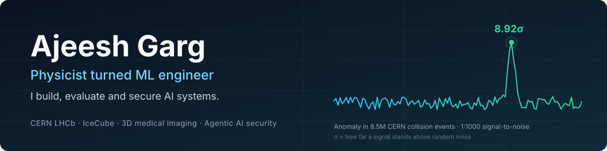

  

  

    
    
    
  

**Physicist by training, ML engineer by practice.** I came to AI through particle physics, where a result only counts if it survives a 5σ standard and a hostile review of every error source. I bring that habit to production AI: systems that are measured, deployed and attacked on purpose before anyone else gets to.

> **Open to:** AI/ML Engineer · Applied & Agentic AI · Data Scientist · Quant/Risk analytics · Computer Vision 
> **Based in** India · open to remote and relocation · **Reach me:** [gargajeesh@gmail.com](mailto:gargajeesh@gmail.com)

| | |
|---|---|
| 🎓 **Education** | Joint International Masters/M.Sc. in Advanced Methods in Particle Physics ([IMAPP](https://imapp.eu)), Université Clermont Auvergne 🇫🇷 → Technical University Dortmund 🇩🇪 → University of Bologna 🇮🇹 · Franco-German University (FGU) scholar |
| 🔬 **Thesis** | *Advanced AI Models for Dose Predictions in matRad*, TU Dortmund. 3D deep learning for Microbeam Radiation Therapy (76 pages) |
| 🧰 **Strengths** | Evaluation and rare-event ML · agent security · RAG · 3D computer vision · large-scale web scraping and data pipelines |

---

## From physics to engineering, translated

Particle physics is applied statistics, large-scale data engineering and compute work. Here is the same work in industry terms.

| What I did | What it means in engineering |
|---|---|
| Found an **8.92σ anomaly** in **8.5M collision events from CERN's LHCb detector** (Large Hadron Collider/particle collider) at **1:1000 signal-to-noise**. First estimate: **8.92σ**. After characterising the equipment’s uncertainty it came down to **4.32σ** | Anomaly detection under extreme class imbalance, with an error budget. The same discipline as fraud and risk modelling: a detection is worth only the part that survives scrutiny of its false-positive sources |
| **IceCube Neutrino Observatory** (a detector array buried in Antarctic ice): Random Forest + mRMR feature selection + decision-threshold tuning + 5-fold cross-validation → **94.5% precision, AUC 0.981** | Imbalanced classification with precision-first threshold tuning and honest validation |
| **Master’s thesis:** 3D U-Net, Attention U-Net and Vision Transformers on 64³ volumes, custom loss for the sparse dose distribution, evaluated on multiple domain-specific metrics: **more than 2× better peak-region MAE** and **50% less training time** (150 vs 300 epochs) | Volumetric computer vision, loss design, multi-GPU training (DDP) on an HTCondor cluster, Optuna tuning, Snakemake workflows, Monte Carlo simulation (Geant4) in Julia to generate training data |
| **Arrest prediction** on 1.1M records: a **3-feature Random Forest matched a 6-layer neural network** (AUC 0.81) | Model selection and interpretability. Permutation importance showed most of the deep model’s cost was unnecessary |

<b>σ (“sigma”)</b> = how many standard deviations a signal sits above random noise. The higher it is, the less likely the signal is a fluke. Physics requires 5σ to call something a discovery.

---

## Featured work

### 🛡️ Agentic AI and security

**[SupportAI Core: multi-agent customer support with layered guardrails](https://github.com/Ajeesh25353646/langchain-langraph-apps/tree/master/Advanced_apps/SupportAI_Core)**
A 10-node LangGraph support agent, evaluated on **640 test prompts: 570 attacks across 10 categories (prompt injection, document poisoning and more) and 70 legitimate requests**, to confirm it blocks the first without refusing the second. Layer 1, a rule-based filter, blocks 44% of attacks and wrongly blocks **none** of the legitimate ones. Layer 2, the agent’s own instructions along with several other tactics (e.g. trust isolation), refused **all 319** attacks that got past layer 1. Personal data is masked before any text reaches the LLM, and high-value refunds wait for human approval. An LLM judge scored 50 test cases at **81.4% correct and 92.2% relevant**. Cold start fell from **51.5 s to 29.1 s**, and warm technical queries now answer in **7.9 s**. Includes Azure Bicep infrastructure code and an honest “Production gaps” section.
`LangGraph` `DeepSeek V4 Flash` `Pinecone` `Presidio` `LangSmith` `Streamlit` `Azure Bicep`

**[Security guide for AI agents, in the style of the OWASP Top 10](https://ajeesh25353646.github.io/OWASP-Agentic-AI-Security-Guide/)** · [repo](https://github.com/Ajeesh25353646/OWASP-Agentic-AI-Security-Guide)
OWASP is the non-profit behind the widely used “Top 10” web-security risk lists. AI agents (LLMs that call tools, browse and take actions) add new ways to be attacked, such as hidden instructions that hijack an agent into leaking data or taking actions its owner never approved. This guide walks through **ten agent-specific risks (AG01–AG10)**, each with diagrams and guardrail code examples, backed by **13 analysed real-world incidents** and **26 diagrams**. It includes a printable **35-item security checklist** and a mapping to the EU AI Act, NIST and SOC 2 for compliance teams. Built for engineers shipping agents and the security reviewers who sign them off. Written and published in 20 commits after months of research.

### ⚙️ Software engineering

**[Azaad: messaging that works with no internet, no SIM](https://github.com/Ajeesh25353646/Azaad)**
An Android app where phones message each other directly over Bluetooth when there is no internet, no SIM network and no servers. Built for disasters and emergencies. Beyond messages, you can share live location, send photos, view an offline map, drop pins for medical help, water, food, safe zones or danger, and broadcast SOS alerts. Photos are sent in small chunks that resume where they left off, so a broken link doesn’t restart the transfer, and the app can even pass its own APK to a nearby phone. Messages hop from phone to phone and are carried along until a route appears; they expire after 24 h, and SOS messages take priority. Built on the open-source `vaidzss/ping` codebase: **114 commits, ~17K lines of Kotlin, 236 automated tests**, a custom 15-message binary protocol, and encryption keys generated on the device. On every push, CI runs a mesh simulator through **13 scenarios** (long relay chains, message expiry, crowd-sized message floods, 10% packet loss, replay attacks, forged messages), so networking bugs are caught before a real phone is involved.
`Kotlin` `Jetpack Compose` `Bluetooth LE` `GitHub Actions`

**[OmniRoute: merged upstream PR #7528](https://github.com/cheaper-inference/OmniRoute/pull/7528)**
OmniRoute routes requests to 230+ AI model providers. Meta AI retired the GraphQL call a provider depended on and every request began returning 502. I worked out the replacement WebSocket protocol, **hand-wrote the protobuf varint encoding** (no library), and rewrote the tests from fetch mocks to WebSocket mocks. Merged: **+796 / −451 lines, 20 commits**.
`TypeScript` `WebSocket` `protobuf` `GraphQL`

### 📊 Applied ML and research

**[Rare-event detection in particle-physics and neutrino data](https://github.com/Ajeesh25353646/ML-from-Raw-Data)** · repo: `ML-from-Raw-Data`
Anomaly detection in 8.5M CERN LHCb collision events, signal classification for the IceCube neutrino detector (94.5% precision, AUC 0.981), and sensor characterisation from scintillator and silicon-strip experiments. Four projects, four different raw data formats, each cleaned and modelled from scratch.

**[Predicting arrests from 1.1M crime records: deep network vs. simple model](https://github.com/Ajeesh25353646/ML-for-Physicists)** · repo: `ML-for-Physicists`
A 6-layer neural network and a Random Forest both reach AUC 0.81, and a Random Forest with only **3 features** matches them. Permutation importance explains why. A worked example of choosing the cheaper model when it performs the same.

**[Private document Q&A over PDFs with images and tables](https://github.com/Ajeesh25353646/langchain-langraph-apps/tree/master/Advanced_apps/Multimodal_PDF_RAG)** · repo folder: `Multimodal_PDF_RAG`
One toggle switches between Gemini in the cloud and a local Gemma3 model via Ollama, so confidential documents never leave the machine. Answers keep page numbers through the whole pipeline, and the README documents its own known gaps.

**[Interactive explainers for 16 ML algorithms](https://ml-visualized.streamlit.app/)** · [repo](https://github.com/Ajeesh25353646/Interactive-Visualisations-for-every-ML-algorithm-) · Drag the parameters, watch 16 algorithms respond, from Linear Regression to Transformers.

### 🔒 Private repos (happy to walk through on a call)

| Project | What it is |
|---|---|
| **Company ATS Detection Toolkit** · 200+ commits | Works out which hiring platform (ATS, e.g. Greenhouse or Ashby) a company uses, with a 4-layer cascade from fast URL matching to browser automation. **14,237 companies across 36 platforms** |
| **Career Ops Pipeline** · 1,700+ commits | Finds jobs from 6–7 sources, scores fit with an LLM, auto-fills application forms, and runs from a terminal dashboard, Gmail Integration, Followup Reminder |
| **RecoGST** · SaaS | **FastAPI + React** SaaS for accountants who file GST returns for many clients. Downloads returns and ledgers from the GST portal for up to 50 clients per run (browser automation + CAPTCHA solving), matches the portal data against purchase books invoice by invoice, risk-scores each vendor (High/Medium/Low), and filters out format-only mismatches so accountants only see real ones. Output is an Excel report plus the original sheets with every mismatch highlighted. Razorpay subscriptions with signed webhooks and monthly quotas; client portal passwords are encrypted. The repo holds three generations of the engine: rule-based → LangGraph → hybrid |
| **MRT dose-prediction thesis code** | 3D U-Net / Attention U-Net / ViT, from Geant4 simulation through Snakemake and multi-GPU training to Optuna tuning |

---

<b>🗓️ Build log 2026</b>

 

| When | What |
|---|---|
| Jul 2025 – Present | [Agentic AI repo](https://github.com/Ajeesh25353646/langchain-langraph-apps): 9 LangGraph apps, from toy chatbots to SupportAI Core |
| Oct – Nov | [SupportAI Core](https://github.com/Ajeesh25353646/langchain-langraph-apps/tree/master/Advanced_apps/SupportAI_Core) open-sourced with evals, tests and Azure infrastructure code |
| Jun | [Security guide for AI agents](https://github.com/Ajeesh25353646/OWASP-Agentic-AI-Security-Guide): 20 commits in a week after months of research, [live site](https://ajeesh25353646.github.io/OWASP-Agentic-AI-Security-Guide/) |
| Jul – Aug | [Azaad](https://github.com/Ajeesh25353646/Azaad): offline Bluetooth messaging app, 100+ commits, installable APK |
| Jul 22 | [OmniRoute PR #7528](https://github.com/cheaper-inference/OmniRoute/pull/7528) merged upstream |
| Apr – Nov | Career Ops pipeline, 1,700+ commits (private) |
| May – Oct | ATS Detection Toolkit, 200+ commits (private) |

---

## Stack

| | |
|---|---|
| **ML / DL** | `PyTorch` `TensorFlow` `scikit-learn` `Optuna` `Pandas` `NumPy` `OpenCV` `TensorBoard` `ROOT` |
| **GenAI / Agents** | `LangChain` `LangGraph` `LangSmith` `multi-agent systems` `RAG` `prompt engineering` `Ollama` `Presidio` |
| **Backend / Data** | `Python` `FastAPI` `SQL` `unit testing (pytest)` `web scraping (Playwright, Selenium)` `aiohttp` |
| **Domains** | `NLP` `Computer Vision` `3D medical imaging` `AI governance & GuardRails` `feature engineering` `statistical analysis` |
| **Mobile / Other** | `Kotlin` `TypeScript` `C++` `Julia` |
| **Infra** | `Docker` `GCP` `AWS` `Azure Bicep` `GitHub Actions (CI/CD)` `distributed training (DDP)` `Snakemake` `HTCondor` |

---

## Writing

- [The Truth About AI Security in 2026: 97% of Companies Are Unprotected](https://medium.com/@gargajeesh/the-truth-about-ai-security-in-2026-97-of-companies-are-unprotected-c1d600ad6830): 11 attack vectors hijacking enterprise agents
- [Beyond Currency Conversion: A Finance Advisor Built with LangGraph](https://medium.com/ai-in-plain-english/beyond-currency-conversion-my-multi-agent-finance-advisor-built-with-langgraph-fe17ee7ec472)

---

  <b>Hiring for AI, ML or data work?</b> I would like to hear about it. 
  <a href="mailto:gargajeesh@gmail.com">gargajeesh@gmail.com</a> · <a href="https://linkedin.com/in/ajeeshgarg">LinkedIn</a> · <a href="https://medium.com/@gargajeesh">Medium</a>

